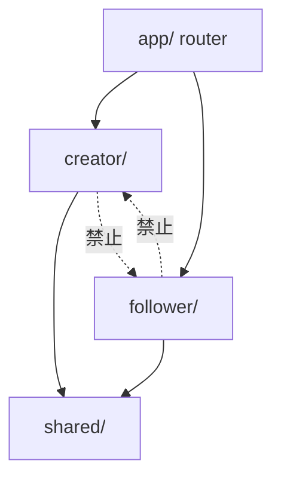
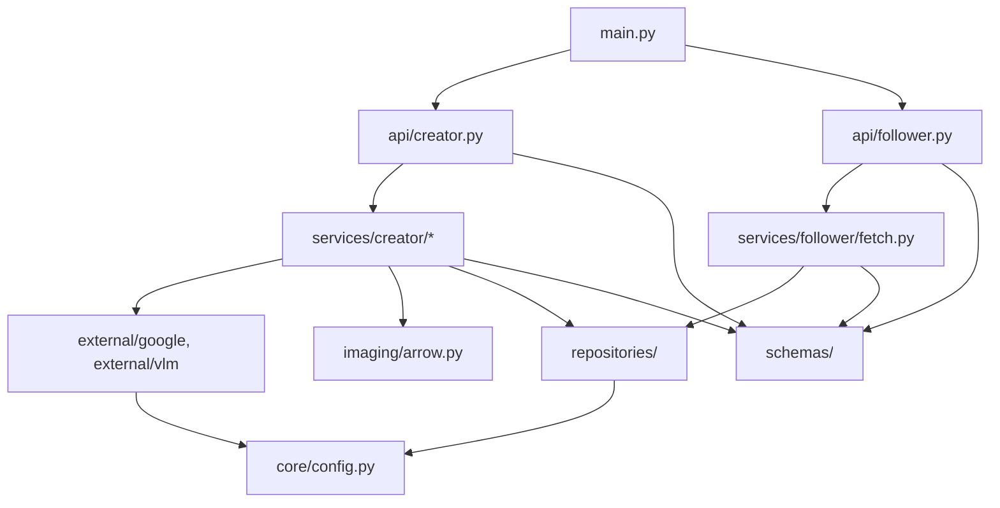
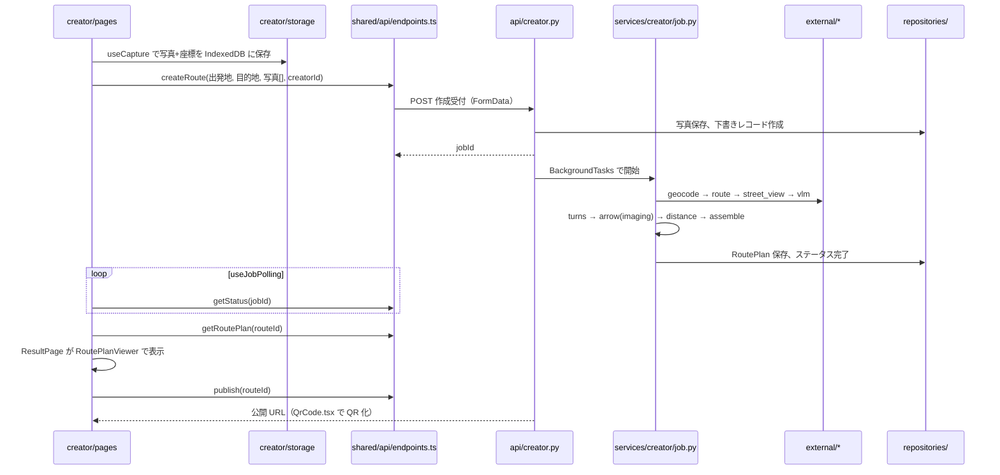
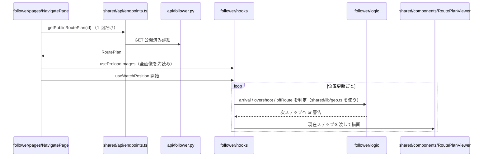

# ディレクトリ構成と各ファイルの関係

全体像は [overview.md](./overview.md)、各役割の作業は [creator.md](./creator.md)、[follower.md](./follower.md) を参照。

## 0. 方針

- フロントは **Vite + React + TypeScript** の 1 アプリ。作る人は `/c/*`、参加者は `/r/:id` とパスで分ける（PWA 化は vite-plugin-pwa）。
- バックエンドは **FastAPI**。作成ジョブは BackgroundTasks で非同期実行。
- 作る人（creator）と参加者（follower）が **並行開発** できるよう、両者の接点を次の 2 つに限定する。
  1. **写真列 JSON**（ステップ配列 + ポリライン）の形
  2. それを描く **表示コンポーネント**（作る人の確認画面と参加者の表示画面で共用）
- 依存は一方向のみ。`creator/` と `follower/` は `shared/` にだけ依存し、互いを import しない。

## 1. ディレクトリ構成

```
hs_2601/
├── docs/                          # 企画・仕様（このファイルを含む）
│
├── frontend/                      # Vite + React + TS、PWA
│   ├── public/                    # PWA アイコン、manifest
│   └── src/
│       ├── app/                   # エントリ、ルーター、全体プロバイダ
│       │   ├── main.tsx           #   React のマウント
│       │   ├── router.tsx         #   /c/* → creator、/r/:id → follower の振り分け
│       │   └── providers.tsx      #   QueryClient 等の全体 Provider
│       │
│       ├── shared/                # 【共有】両者が使うもの。変更時は両者で相談
│       │   ├── types/
│       │   │   └── routePlan.ts   #   写真列 JSON の型。backend/schemas/route_plan.py と 1:1
│       │   ├── api/
│       │   │   ├── client.ts      #   fetch ラッパー（base URL、エラー整形）
│       │   │   └── endpoints.ts   #   5 本の API のパスと型付き関数
│       │   ├── components/
│       │   │   ├── StepView.tsx   #   1 ステップの表示（写真 + 矢印 + 目印文 + 距離）
│       │   │   └── RoutePlanViewer.tsx  # 写真列全体の表示。前へ・次へを持つ
│       │   ├── lib/
│       │   │   ├── geo.ts         #   turf.js を使う距離・方位・ポリライン距離
│       │   │   └── constants.ts   #   到達しきい値などの定数
│       │   └── fixtures/
│       │       └── sampleRoutePlan.json  # バックエンドなしで開発するためのサンプル
│       │
│       ├── creator/               # 【作る人】
│       │   ├── pages/
│       │   │   ├── HomePage.tsx            # 「道を作る」「公開する」の 2 ボタン
│       │   │   ├── RouteInputPage.tsx      # 出発地・目的地入力
│       │   │   ├── CapturePage.tsx         # 撮影 ⇄ 撮った写真の一覧
│       │   │   ├── CreatingPage.tsx        # 作成中（ポーリング）
│       │   │   ├── ResultPage.tsx          # 作成結果の確認（RoutePlanViewer を使う）
│       │   │   ├── RouteListPage.tsx       # 作った道の一覧（チェック選択）
│       │   │   └── PublishedPage.tsx       # 公開完了（URL・QR）
│       │   ├── components/
│       │   │   ├── CaptureButton.tsx       # <input capture> を包む
│       │   │   ├── PhotoThumbnailList.tsx  # サムネイル + 削除
│       │   │   └── QrCode.tsx              # qrcode.react の薄いラッパー
│       │   ├── hooks/
│       │   │   ├── useCapture.ts           # File 取得と同時に Geolocation で座標を取る
│       │   │   └── useJobPolling.ts        # ステータス API を数秒おきに叩く
│       │   └── storage/
│       │       ├── photoStore.ts           # IndexedDB（idb-keyval）に写真と座標を保存
│       │       └── creatorId.ts            # localStorage の作成者 ID
│       │
│       └── follower/              # 【参加者】
│           ├── pages/
│           │   ├── EntryPage.tsx           # ID 入力して遷移（デモ用）
│           │   └── NavigatePage.tsx        # 道案内表示（RoutePlanViewer を使う）
│           ├── components/
│           │   └── OvershootAlert.tsx      # 通り過ぎ・経路外れ警告のオーバーレイ
│           ├── hooks/
│           │   ├── useWatchPosition.ts     # Geolocation.watchPosition
│           │   ├── useStepProgress.ts      # 現在地と写真列から現在ステップを更新
│           │   └── usePreloadImages.ts     # 全ステップ画像の先読み
│           └── logic/                      # 純関数。単体テスト対象
│               ├── arrival.ts              # 到達判定（15〜20m）
│               ├── overshoot.ts            # 通り過ぎ判定（距離が縮んだ後、数回連続で広がる）
│               └── offRoute.ts             # 経路外れ判定（ポリラインから 30〜50m）
│
├── backend/                       # FastAPI
│   ├── app/
│   │   ├── main.py                # アプリ生成、CORS、ルーター登録
│   │   ├── core/                  # 【共有】
│   │   │   ├── config.py          #   .env 読み込み（API キー、DB 接続先、ストレージ種別）
│   │   │   └── logging.py         #   ログ設定
│   │   ├── schemas/               # 【共有】Pydantic
│   │   │   ├── route_plan.py      #   写真列 JSON（Step、RoutePlan）。frontend/shared/types/routePlan.ts と 1:1
│   │   │   ├── creator.py         #   作成受付の入力、ジョブ状態、一覧、公開結果
│   │   │   └── follower.py        #   公開済み詳細取得のレスポンス
│   │   ├── repositories/          # 【共有】永続化。Supabase と SQLite+ローカルファイルを差し替え可能に
│   │   │   ├── base.py            #   インターフェース（RoutePlanRepository、PhotoStorage）
│   │   │   ├── sqlite_repo.py     #   開発用
│   │   │   └── supabase_repo.py   #   本番用
│   │   ├── external/              # 【共有】外部 API クライアント
│   │   │   ├── google/
│   │   │   │   ├── geocoding.py   #   住所 → 緯度経度
│   │   │   │   ├── routes.py      #   徒歩経路（経由地の順序最適化）
│   │   │   │   └── street_view.py #   Metadata で有無確認 → Static で画像取得
│   │   │   └── vlm/
│   │   │       ├── base.py        #   VLM インターフェース（describe_landmark）
│   │   │       ├── claude.py      #   Claude API 実装
│   │   │       ├── fallback.py    #   VLM 不可時に「○m 先を右」を返す
│   │   │       └── prompts/
│   │   │           └── landmark.txt  # 目印抽出プロンプト
│   │   ├── imaging/               # 【共有】
│   │   │   └── arrow.py           #   Pillow で画像に矢印を重ねる
│   │   ├── api/
│   │   │   ├── creator.py         # 【作る人】POST 作成受付 / GET ステータス / GET 一覧 / POST 公開
│   │   │   └── follower.py        # 【参加者】GET 公開済み詳細
│   │   └── services/
│   │       ├── creator/           # 【作る人】作成ジョブ。1 ステップ 1 ファイル
│   │       │   ├── job.py         #   パイプライン全体の実行と状態更新
│   │       │   ├── geocode.py     #   1. ジオコーディング
│   │       │   ├── route.py       #   2. 経路計算
│   │       │   ├── turns.py       #   3. 曲がり角の抽出（作成者の撮影地点は必ず含める）
│   │       │   ├── streetview.py  #   4. 写真がない曲がり角の Street View 取得
│   │       │   ├── landmark.py    #   5. VLM で目印文を生成
│   │       │   ├── arrow.py       #   6. 方位差から左右折判定 → imaging/arrow.py で描画
│   │       │   ├── distance.py    #   7. 次ステップまでの距離
│   │       │   └── assemble.py    #   8. RoutePlan を組み立てて保存
│   │       └── follower/
│   │           └── fetch.py       # 【参加者】公開済みのものだけ返す
│   └── tests/
│       ├── creator/  follower/  shared/
│       └── fixtures/              # Routes API のレスポンス例、サンプル画像
│
├── infra/                         # docker-compose、Cloudflare Tunnel / ngrok の手順
├── scripts/                       # セットアップ、サンプルデータ投入
├── .github/workflows/             # lint / test
├── .env.example
└── README.md
```

## 2. 依存関係（import してよい方向）

### フロントエンド



- `shared/` は `creator/` と `follower/` を import しない。
- 上の禁止は ESLint の `no-restricted-imports` で機械的に守る。

### バックエンド



- `api/` はルーティングと入出力の変換だけ。ロジックは `services/` に置く。
- `services/` は `external/`、`imaging/`、`repositories/` を呼ぶが、逆方向はない。
- `external/`、`imaging/`、`repositories/` は互いを知らない。

## 3. フロントとバックの接点

| 接点 | フロント側 | バック側 | 備考 |
|---|---|---|---|
| 写真列 JSON の型 | `shared/types/routePlan.ts` | `schemas/route_plan.py` | 片方を変えたら必ずもう片方も変える |
| 5 本の API | `shared/api/endpoints.ts` | `api/creator.py`、`api/follower.py` | パスと入出力は overview.md 4 章 |
| 画像 | `StepView.tsx` が `imageUrl` を表示 | `repositories/` のストレージが公開 URL を発行 | フロントは URL をそのまま使う |

## 4. データの流れ

### 作る人: 作成〜公開



### 参加者: 表示〜位置判定



参加者側からバックエンドへの送信はない（統計はスコープ外）。

## 5. 並行開発の進め方

1. **最初に決めるもの**: `schemas/route_plan.py` と `shared/types/routePlan.ts`、`shared/fixtures/sampleRoutePlan.json`。この 3 つがあれば以降は待ち時間が出ない。
2. **参加者担当**: fixture を読み込んで `follower/logic/` と `NavigatePage` を先に作る。バックエンドは最後につなぐだけ。
3. **作る人担当（フロント）**: 撮影・IndexedDB・ポーリングを作る。`ResultPage` は `RoutePlanViewer` を使うので表示を自作しない。
4. **作る人担当（バック）**: `services/creator/` を 1 ファイルずつ埋める。VLM 担当は `external/vlm/` と `landmark.py`、経路担当は `external/google/` と `route.py`、`turns.py` を並行して進められる。
5. **共有部分の変更**: `shared/`、`schemas/`、`external/`、`imaging/`、`repositories/` を触るときは両者に声をかける。

## 6. 各ディレクトリの README.md

ディレクトリを作成する際、上記の【】付きディレクトリと `pages/`、`logic/`、`services/creator/` には README.md を置き、次の 4 項目で統一する。

- 役割
- 置くもの・置かないもの
- 依存してよい相手
- 担当
